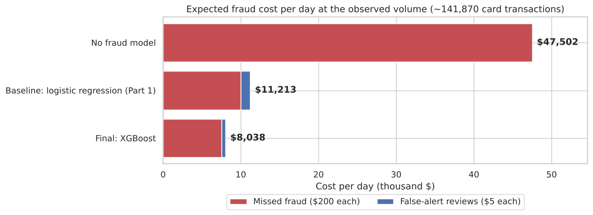
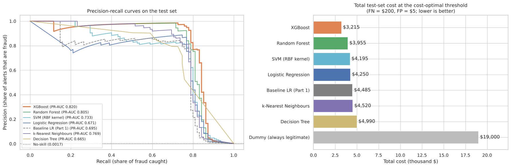
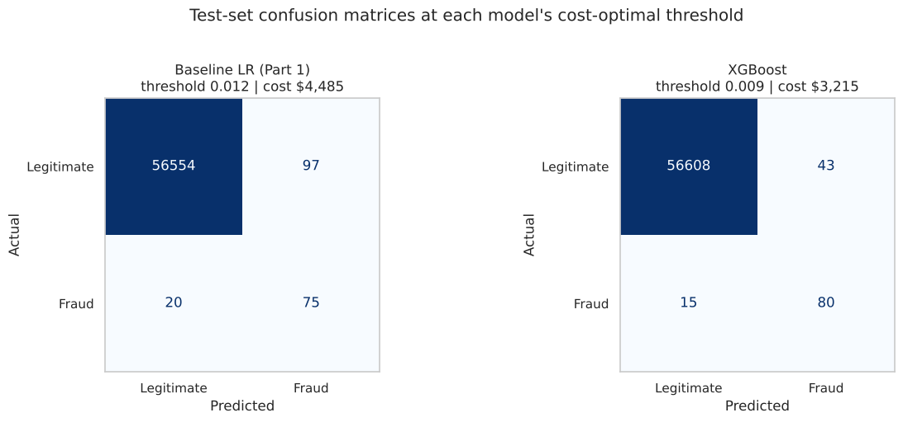
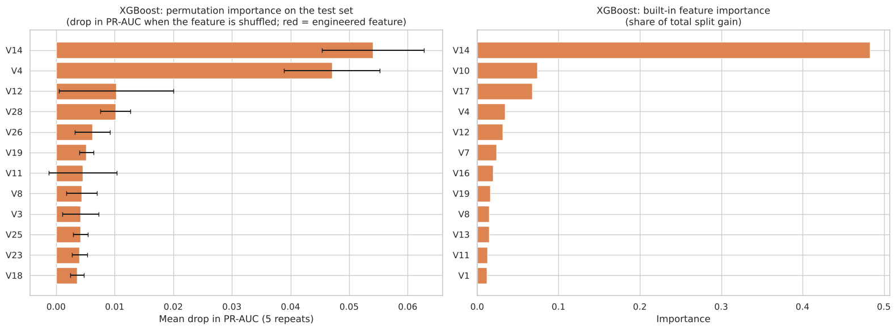

### Credit Card Fraud Detection under Extreme Class Imbalance

**Asit Kar**

#### Executive summary
Card fraud is rare (about 1 in every 600 transactions in this dataset), but every missed fraud is expensive. This project built and compared seven fraud-detection models and judged them on **what they would cost the bank**, not on accuracy. The cost of a missed fraud is set at \$200 and the cost of a false alert at \$5.

**The recommended model is XGBoost, a gradient-boosted decision tree model.** On 56,746 transactions it had never seen:

- It **caught 80 of the 95 frauds (84%)**.
- **65% of its alerts were real fraud**, against 44% for the logistic regression baseline built in the first stage of the project. Fraud analysts would review fewer and better alerts.
- The **total cost of fraud fell from \$4,485 with the baseline to \$3,215**, a **28% saving**. With no model at all, the same transactions would have cost \$19,000.
- At this dataset's volume (about 142,000 transactions a day), that is **about \$8,000 a day, against \$11,200 a day for the baseline and \$47,500 a day with no fraud model**.

A statistical check (bootstrap) puts the saving over the baseline at between roughly \$490 and \$2,290 on this test set, so the improvement is very unlikely to be luck. The main caveat: when the model was trained on earlier transactions and tested on later ones, it still ranked fraud better than the baseline, but the alert cut-off needed re-tuning. **The model should be piloted alongside the current process, and its alert threshold monitored, before it goes live.**

#### Rationale
Credit card fraud costs the global banking industry more than \$35 billion a year. Every missed fraud is money lost and a customer let down, and every false alert blocks a genuine customer and takes up analyst time. Regulators (PCI-DSS, PSD2, RBI guidelines) also expect banks to show that their automated fraud models are auditable and cost-aware. A model that is simply "99.8% accurate" can still catch no fraud at all, so models have to be judged on what their mistakes cost.

#### Research Question
Can a supervised machine learning model accurately tell fraudulent transactions from legitimate ones while keeping the total business cost of missed fraud (false negatives) and blocked legitimate customers (false positives) as low as possible? The model is trained on anonymised credit card transaction features and built to handle extreme class imbalance (~0.17% fraud).

#### Data Sources
[Credit Card Fraud Detection](https://www.kaggle.com/datasets/mlg-ulb/creditcardfraud) from the ULB Machine Learning Group (Kaggle). It contains 284,807 European card transactions made over two days in September 2013. There are 30 features: `Time`, `Amount`, and `V1`–`V28`, which are anonymised PCA components whose original meaning is confidential. The target is `Class` (1 = fraud), with 492 frauds (0.172%).

The CSV (~100 MB) is not committed to this repo. Both notebooks read `data/creditcard.csv` if it exists and otherwise load the file from a public GitHub mirror automatically.

#### Methodology
**Part 1: data preparation and baseline** ([notebook](notebooks/fraud_detection_eda_baseline.ipynb))
1. **Cleaning:** no missing values. Removed 1,081 exact duplicate rows, leaving 283,726 transactions and 473 frauds.
2. **Outliers:** kept on purpose. Transactions that are outliers on any of five key components make up 8% of rows but contain 89% of all fraud.
3. **EDA:** class imbalance, feature separability (KS statistic), fraud rate by amount and by hour of day, and correlations.
4. **Feature engineering:** `log_amount`, a micro-transaction flag (≤ €1, typical of "card testing"), a night-time flag, and a cyclical hour of day.
5. **Baseline:** logistic regression with a cost-tuned decision threshold.

**Part 2: modelling and final recommendation** ([notebook](notebooks/fraud_detection_model_comparison.ipynb))
1. **Evaluation metric:** **PR-AUC** (precision-recall area under the curve) is the primary metric. It measures how well a model ranks real fraud above legitimate transactions, and a random guess scores only 0.0017. ROC-AUC and accuracy look excellent for almost any model on data this imbalanced, so they were not used to choose between models. **Expected cost** (\$200 per missed fraud, \$5 per false alert) is used to set each model's alert threshold.
2. **Class imbalance:** compared no adjustment, class weights, random undersampling and SMOTE oversampling, with resampling applied inside cross-validation only.
3. **Six models tuned with `GridSearchCV`** (5-fold stratified cross-validation, scored on PR-AUC): Logistic Regression, k-Nearest Neighbours, Decision Tree, SVM (RBF kernel), Random Forest and XGBoost.
4. **Cost-optimal threshold:** for each model, the alert cut-off that minimises cost on out-of-fold training predictions.
5. **Final test:** every model is evaluated once on the same untouched 20% test set (56,746 transactions, 95 frauds).
6. **Reliability checks:** bootstrap confidence intervals, sensitivity to the cost assumptions, an out-of-time test (train on the first 40 hours, test on the last 8), and feature importance.

#### Results

##### 1. Model comparison (unseen test set)

| Model | CV PR-AUC | Test PR-AUC | Fraud caught | Alerts that are fraud | Missed frauds | False alerts | **Total cost** |
|---|---|---|---|---|---|---|---|
| **XGBoost (recommended)** | **0.853** | **0.820** | **84% (80/95)** | **65%** | **15** | **43** | **\$3,215** |
| Random Forest | 0.836 | 0.805 | 81% (77/95) | 52% | 18 | 71 | \$3,955 |
| SVM (RBF kernel) | 0.745 | 0.733 | 79% (75/95) | 66% | 20 | 39 | \$4,195 |
| Logistic Regression (tuned) | 0.757 | 0.671 | 79% (75/95) | 60% | 20 | 50 | \$4,250 |
| Baseline: Logistic Regression (Part 1) | – | 0.695 | 79% (75/95) | 44% | 20 | 97 | \$4,485 |
| k-Nearest Neighbours | 0.792 | 0.769 | 79% (75/95) | 42% | 20 | 104 | \$4,520 |
| Decision Tree | 0.767 | 0.665 | 75% (71/95) | 65% | 24 | 38 | \$4,990 |
| No model (flag nothing) | – | 0.002 | 0% | – | 95 | 0 | \$19,000 |

Every model is shown at its own cost-optimal threshold. "CV PR-AUC" is the cross-validated score on the training data, which was used to choose the model. The test-set results confirm the same ranking.

##### 2. Key findings

- **Tree ensembles win.** XGBoost and Random Forest clearly beat the linear, distance-based and single-tree models. Fraud shows up as combinations of unusual values across several features, and ensembles of trees capture those combinations best.
- **The alert threshold matters as much as the model.** A model gives every transaction a fraud score, and the bank decides above which score to raise an alert. The usual default (a 50% probability) is far too cautious here, because a missed fraud costs 40 times as much as a false alert. Setting the cut-off from costs instead cut XGBoost's test cost from \$4,610 to \$3,215.
- **XGBoost improves on the baseline in both directions.** It catches 5 more frauds (\$1,000 saved) and raises 54 fewer false alerts (\$270 saved).
- **The improvement is statistically reliable.** Across 2,000 bootstrap resamples of the test set, XGBoost saved between about \$490 and \$2,290 (95% confidence interval) and was cheaper in virtually every resample.
- **Simple imbalance handling is enough.** Re-weighting the classes or generating synthetic fraud cases (SMOTE) did no better than training on the data as it is. Throwing away legitimate transactions (undersampling) made models worse.
- **Two signals drive most decisions.** The anonymised components V14 and V4 matter most, which matches the exploratory analysis in Part 1. The engineered time and amount features add only a small amount.
- **The result holds under different cost assumptions.** XGBoost is cheaper than the baseline whether a missed fraud costs \$50 or \$1,000. Its advantage grows as fraud gets more expensive.

##### 3. Recommendations

> - **Adopt XGBoost as the fraud-scoring model, starting in "shadow mode":** score live transactions alongside the current process for a few weeks, without acting on the scores, and compare outcomes before switching over.
> - **Set the alert threshold from the bank's own costs**, not from a default 50% probability. With \$200 / \$5 costs it flags about 2 in every 1,000 transactions (about 300 alerts a day at this volume). Re-tune the threshold whenever cost estimates change. This needs no retraining.
> - **Monitor the alert rate and threshold weekly**, and retrain when performance on recently confirmed fraud falls. Fraud patterns drift over time.
> - **Plan analyst capacity** for about 300 alerts a day per 142,000 transactions. That is about 120 fewer alerts a day than the baseline, while catching more fraud.

##### 4. Limitations
- **Only two days of data from 2013.** In the out-of-time test (train on the first 40 hours, test on the last 8), XGBoost still ranked fraud better (PR-AUC 0.799 vs 0.748) and raised far fewer false alerts (43 vs 121). It missed 3 more frauds at the threshold chosen on earlier data, however, so its cost was similar to the baseline's (\$3,215 vs \$3,005). The threshold needs monitoring as patterns change.
- **The test set holds only 95 frauds**, so the exact savings figures carry real uncertainty (see the confidence interval above).
- **The features are anonymised** (PCA components), so the model can say *which* signals drove an alert but not what they mean in business terms.
- **The \$200 / \$5 costs are flat estimates.** In reality a large fraud costs more than a small one.

##### Glossary
| Term | Plain-English meaning |
|---|---|
| Recall ("fraud caught") | Of all real frauds, the share the model flagged |
| Precision ("alerts that are fraud") | Of all alerts raised, the share that were real fraud |
| Threshold / cut-off | The fraud score above which a transaction is flagged for review |
| PR-AUC | A single 0–1 score for how well the model ranks fraud above legitimate transactions across all thresholds (random = 0.0017, perfect = 1) |
| Cross-validation | Repeatedly training on part of the data and testing on the rest, to estimate performance without touching the final test set |
| Grid search | Trying every combination of a model's settings and keeping the one with the best cross-validated score |
| Bootstrap confidence interval | The range a result would plausibly fall in if the test were repeated on similar data |

#### Next steps
- **Validate on a longer, more recent history** of transactions, including a proper out-of-time test over weeks or months.
- **Add behavioural features** that this anonymised dataset lacks: customer spending velocity, merchant risk, device and location.
- **Explain individual alerts** (for example with SHAP values) so analysts can see why each transaction was flagged.
- **Make cost depend on transaction amount** and calibrate the model's probabilities, so the threshold reflects how much is at stake.
- **Deploy as a monitored service:** an API with automated retraining, drift monitoring and a model card (MLOps practices).

#### Outline of project

- [Part 1: Data cleaning, EDA and baseline model](notebooks/fraud_detection_eda_baseline.ipynb)
- [Part 2: Model comparison, tuning and final recommendation](notebooks/fraud_detection_model_comparison.ipynb)
- `images/`: figures exported from the notebooks
- `requirements.txt`: Python packages needed to run the notebooks

**To reproduce:** `pip install -r requirements.txt`, then run the notebooks in order from the `notebooks/` folder. Part 2 takes about 16 minutes on a 2-core machine. Optionally, place `creditcard.csv` from Kaggle in a `data/` folder to avoid the download.

##### Contact and Further Information
Asit Kar · Post Graduate Program in AI and Machine Learning (UC Berkeley Executive Education / Emeritus) · [github.com/asitkar](https://github.com/asitkar)
